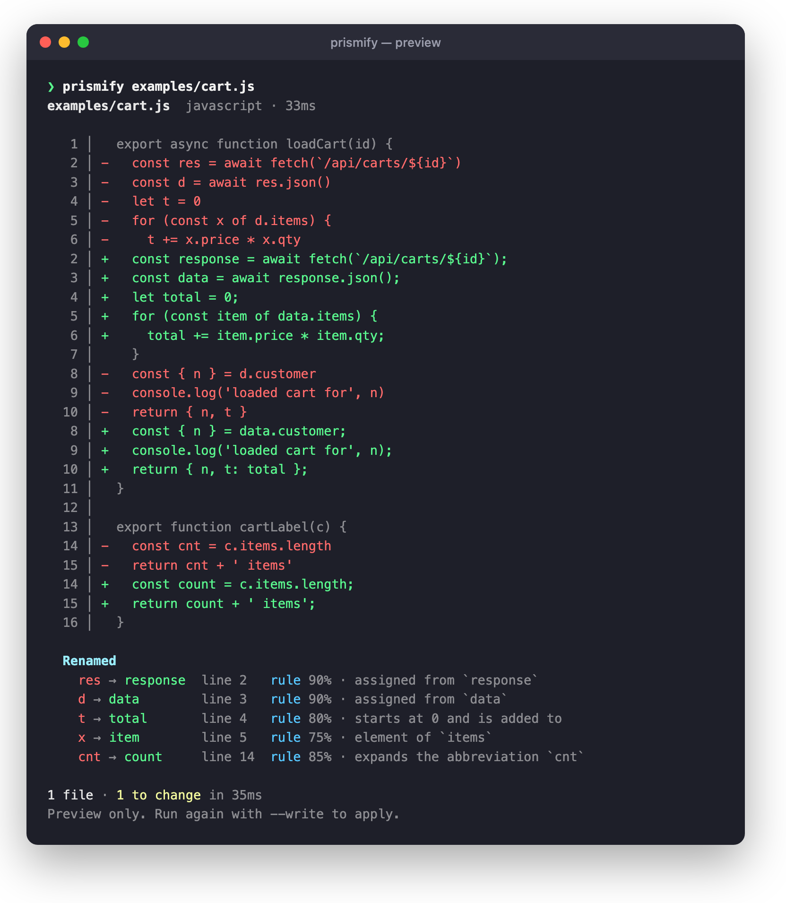
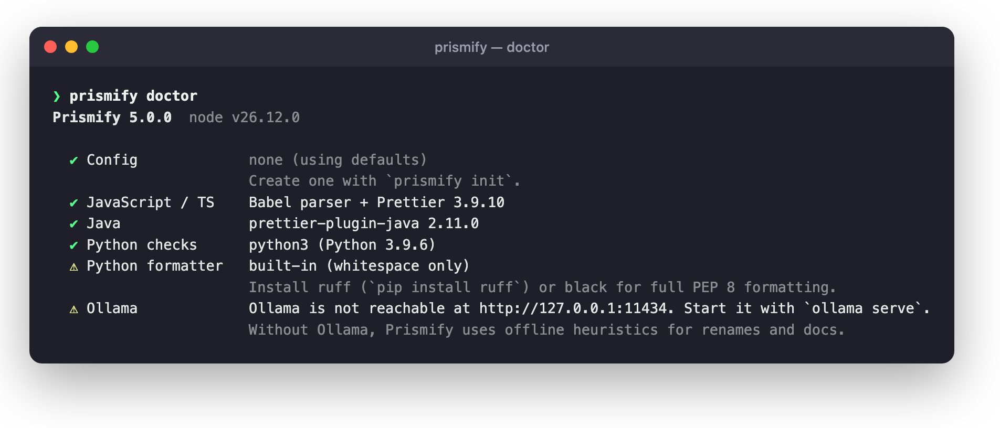
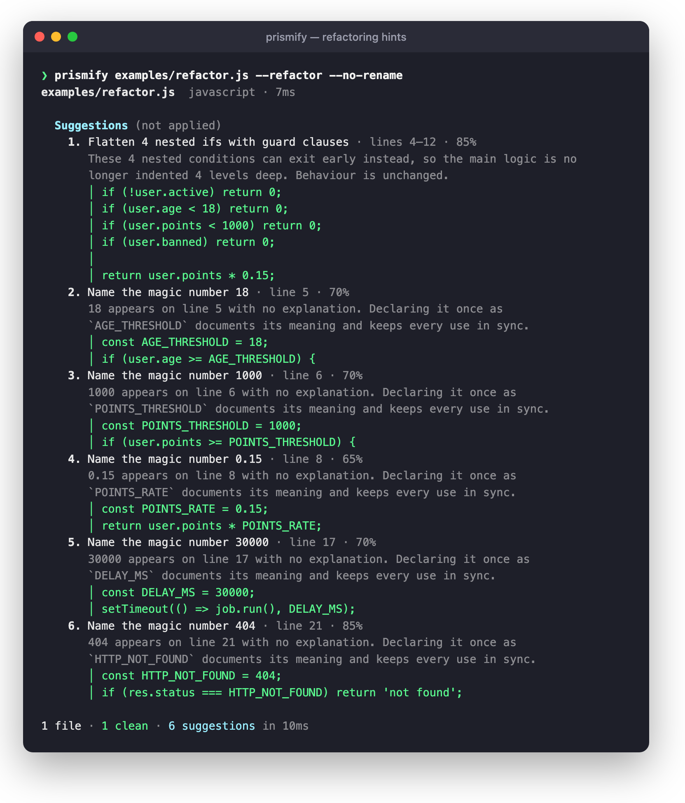
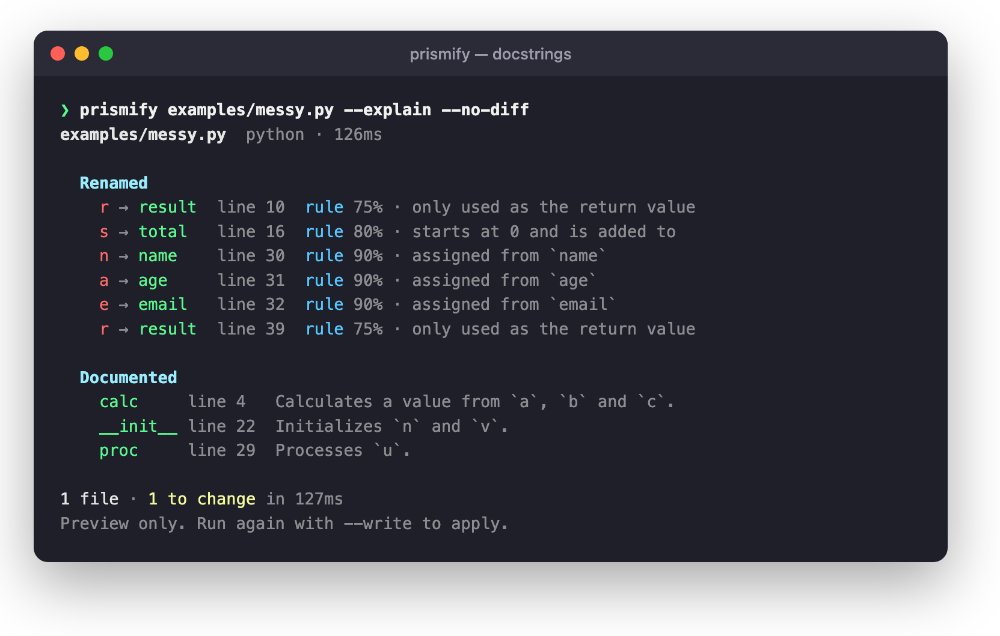
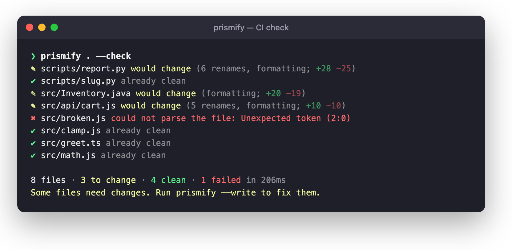

# Prismify

**Make code easier to read, without breaking it.** Prismify renames cryptic local variables, formats your code, adds doc comments, and points out magic numbers and deep nesting, for JavaScript, TypeScript, Python and Java.

It runs locally. Names come from offline rules or from a local model through [Ollama](https://ollama.com); your code never leaves your machine.

[](https://github.com/pronzzz/prismify/actions/workflows/ci.yml)
[](https://github.com/pronzzz/prismify/releases)
[](LICENSE)


<p align="center">
  
</p>

## Contents

- [What it does](#what-it-does)
- [Install](#install)
- [Quick start](#quick-start)
- [Using Ollama for better names](#using-ollama-for-better-names)
- [Python and Java setup](#python-and-java-setup)
- [Commands and options](#commands-and-options)
- [Configuration file](#configuration-file)
- [CI, git hooks and watch mode](#ci-git-hooks-and-watch-mode)
- [VS Code extension](#vs-code-extension)
- [How Prismify keeps your code safe](#how-prismify-keeps-your-code-safe)
- [Using it as a library](#using-it-as-a-library)
- [Development](#development)

## What it does

| | JavaScript / TypeScript | Python | Java |
| --- | :---: | :---: | :---: |
| Rename unclear local variables | ✅ | ✅ | — |
| Format | Prettier | ruff / black / built-in | prettier-plugin-java |
| Add doc comments (`--explain`) | JSDoc | docstrings | Javadoc |
| Suggest named constants (`--refactor`) | ✅ | ✅ | ✅ |
| Suggest guard clauses for nested ifs (`--refactor`) | ✅ | ✅ | ✅ |
| Report dead and debug code (`--dead-code`) | ✅ | ✅ | ✅ |
| Syntax check before and after | Babel | `python3` | prettier-plugin-java |

- **Previews by default.** Nothing is written until you pass `--write`.
- **Renames need evidence.** `const n = user.name` becomes `name`; `for (const x of users)` becomes `user`; `let t = 0; … t += …` becomes `total`. A single letter with no evidence is left alone.
- **Suggestions are never applied automatically.** Refactoring hints are printed for you to review.

## Install

Requires **Node.js 20 or newer**. Install the prebuilt package from the latest GitHub release:

```bash
npm install -g https://github.com/pronzzz/prismify/releases/latest/download/prismify.tgz
```

To pin a version, use its tarball instead (for example `…/releases/download/v5.0.0/prismify-5.0.0.tgz`). The same URL works as a project dev dependency:

```bash
npm install --save-dev https://github.com/pronzzz/prismify/releases/download/v5.0.0/prismify-5.0.0.tgz
```

Or build from source:

```bash
git clone https://github.com/pronzzz/prismify.git
cd prismify
npm install        # installs dependencies and builds dist/
npm link           # puts `prismify` on your PATH
```

Then check your setup:

```bash
prismify doctor
```

<p align="center">
  
</p>

Every check except Node is optional. Without Ollama, Prismify uses its offline rules. Without ruff or black, Python gets whitespace-only formatting.

## Quick start

```bash
prismify src/app.js               # preview renames and formatting for one file
prismify src --write              # apply changes to every supported file under src/
prismify src/app.js --explain     # also add doc comments to undocumented functions
prismify src/app.js --refactor    # show refactoring suggestions
prismify . --check --no-rename    # CI: exit 1 if any file needs formatting
cat a.ts | prismify - -l ts       # read stdin, write the result to stdout
```

The repository ships with example files to try (from a clone):

```bash
prismify examples/cart.js
prismify examples/refactor.js --refactor
prismify examples/messy.py --explain
```

### Refactoring suggestions

`--refactor` finds magic numbers and gives them a name based on how they're used, and turns deeply nested `if`s into guard clauses, negating each condition correctly.

<p align="center">
  
</p>

### Doc comments

`--explain` documents functions that don't have a doc comment yet. Without Ollama, a summary is written only when the function's name says what it does (`calculateTotal` → "Calculates the total."). With Ollama, the model reads the function body. Use `--explain-level beginner` or `pr-review` for more detail.

<p align="center">
  
</p>

## Using Ollama for better names

The offline rules only rename when the code makes the meaning obvious. A local model can do better with names like `calc(a, b, c)`.

1. Install Ollama from [ollama.com/download](https://ollama.com/download) (or `brew install ollama`).
2. Pull a code model:

   ```bash
   ollama pull qwen2.5-coder:7b
   ```

   Smaller machines can use `qwen2.5-coder:1.5b`. Any model works; Prismify picks an installed code model (names containing `coder`, `code`, `deepseek`, `qwen` and so on) automatically.
3. Make sure the server is running (`ollama serve`, or the desktop app), then:

   ```bash
   prismify src/app.js                         # auto: uses Ollama when it's reachable
   prismify src/app.js --provider ollama       # require Ollama
   prismify src/app.js --model llama3.1:8b     # pick a model
   ```

To reduce bad suggestions, Prismify asks the model 3 times (`--ai-checks`) and only applies a name that most runs agree on. Every name is also checked for reserved words and naming conventions. The report marks each rename as `ai` or `rule` so you can see where it came from.

| Setting | Flag | Environment variable |
| --- | --- | --- |
| Server | `--ollama-host` | `OLLAMA_HOST` (default `http://127.0.0.1:11434`) |
| Model | `--model` | `OLLAMA_MODEL` |
| Agreement runs | `--ai-checks` | — |
| Minimum confidence | `--confidence` (default `0.7`) | — |

## Python and Java setup

**Python** needs `python3` on your PATH so Prismify can check that the output still parses. For full PEP 8 formatting install [ruff](https://docs.astral.sh/ruff/) or [black](https://black.readthedocs.io/):

```bash
pip install ruff        # or: pipx install ruff / brew install ruff
```

Prismify uses ruff, then black, then its built-in formatter. Your `pyproject.toml` / `ruff.toml` settings are respected. To force one, set `PRISMIFY_PYTHON_FORMATTER=ruff|black|builtin`. To use a specific interpreter, set `PRISMIFY_PYTHON=/path/to/python`.

**Java** needs nothing extra: formatting and syntax checks use `prettier-plugin-java`, which is bundled. Java variables aren't renamed yet.

## Commands and options

```
prismify [paths...] [options]
```

Paths can be files, directories (expanded using `.gitignore`), or `-` for stdin.

| Option | What it does |
| --- | --- |
| `-w, --write` | Write changes to disk (default: preview only) |
| `-c, --check` | Exit with code 1 if any file would change |
| `--stdout` | Print the resulting code instead of a report (one file) |
| `--json` | Machine-readable output, including a unified diff |
| `--diff` / `--no-diff` | Always / never show diffs |
| `-s, --style <profile>` | `google`, `airbnb`, `minimal`, `python`, `java`, `competitive` |
| `--detect-style` | Keep the file's own indentation, quotes and semicolons |
| `--provider <type>` | `auto` (default), `ollama`, `heuristic` |
| `--model <name>` | Ollama model |
| `--confidence <0-1>` | Minimum confidence to apply a rename (default `0.7`) |
| `--no-rename` | Format only |
| `--no-format` | Rename only |
| `-e, --explain` | Add doc comments |
| `--explain-level <level>` | `production` (default), `pr-review`, `beginner` |
| `-r, --refactor` | Suggest named constants and guard clauses |
| `-d, --dead-code` | Report unreachable code and debug statements |
| `-l, --language <lang>` | Force `js`, `ts`, `python` or `java` |
| `--stdin-filepath <path>` | Filename to use for stdin (picks language and config) |
| `--no-project-config` | Ignore `.prettierrc` / `pyproject.toml` formatter settings |
| `-v, --verbose` | Show skipped renames and full suggestions |
| `-q, --quiet` | Only print errors and the summary |

| Command | What it does |
| --- | --- |
| `prismify doctor` | Check Node, Python tools, Ollama and config |
| `prismify init` | Create a `.prismifyrc.json` |
| `prismify styles` | List style profiles |
| `prismify watch <path>` | Re-run on every save (writes changes) |
| `prismify hook install` | Install a git pre-commit hook |

Exit codes: `0` success, `1` a file failed or `--check` found changes, `2` usage error.

### Style profiles

| Profile | Indent | Quotes | Width | Renames |
| --- | --- | --- | --- | --- |
| `airbnb` (JS/TS default) | 2 spaces | single | 100 | names under 3 chars |
| `google` | 2 spaces | single | 80 | single letters |
| `python` (Python default) | 4 spaces | double | 79 | single letters |
| `java` (Java default) | 4 spaces | double | 100 | — |
| `minimal` | 2 spaces | single | 120 | none |
| `competitive` | 2 spaces | single | 100 | none |

In profiles that rename, known abbreviations (`cnt`, `msg`, `cfg`, `idx`, …) are expanded whatever their length. A project's Prettier config wins over the profile's formatting settings.

## Configuration file

Run `prismify init` to create `.prismifyrc.json`:

```json
{
  "style": "airbnb",
  "provider": "auto",
  "confidence": 0.7,
  "explainLevel": "production",
  "projectConfig": true,
  "ignore": []
}
```

Prismify looks for `.prismifyrc.json`, `.prismifyrc`, `prismify.config.json` or a `"prismify"` key in `package.json`, starting in the file's directory and moving up. Command-line flags override the file.

| Key | Type | Meaning |
| --- | --- | --- |
| `style` | string | Style profile |
| `provider` | `auto` \| `ollama` \| `heuristic` | Naming provider |
| `model`, `ollamaHost`, `aiChecks` | string, string, number | Ollama settings |
| `confidence` | number | Minimum rename confidence |
| `rename`, `format`, `explain`, `refactor`, `deadCode` | boolean | Turn steps on or off |
| `explainLevel` | string | Doc comment detail |
| `projectConfig` | boolean | Respect Prettier / pyproject settings |
| `ignore` | string[] | Extra glob patterns to skip (`node_modules`, `dist`, `build`, minified files and so on are always skipped) |

## CI, git hooks and watch mode

<p align="center">
  
</p>

**GitHub Actions**

```yaml
- uses: actions/setup-node@v4
  with:
    node-version: 22
- run: npm install -g https://github.com/pronzzz/prismify/releases/latest/download/prismify.tgz
- run: prismify . --check --no-rename
```

`--no-rename` keeps CI deterministic: only formatting is checked.

**Pre-commit hook**

```bash
prismify hook install                    # block commits whose staged files need formatting
prismify hook install --mode write       # format staged files and re-stage them
prismify hook install --args "--style google"
prismify hook uninstall                  # restores any hook you had before
```

**Watch mode**

```bash
prismify watch src --no-rename
```

## VS Code extension

The [`vscode-extension/`](vscode-extension/) folder has an extension that runs the CLI on the open file and applies the result as a normal edit (undo works). It adds *Beautify File*, *Format File*, *Add Doc Comments* and *Show Refactoring Suggestions* commands and an optional format-on-save. See its [README](vscode-extension/README.md) to build and install it.

## How Prismify keeps your code safe

- **Broken input is left alone.** If a file doesn't parse, Prismify reports the error and changes nothing.
- **Only local variables are renamed.** Exports, globals, imports, object keys, class members and attributes are never touched. In Python, function parameters are kept too, since callers may pass them by keyword.
- **Scope-aware.** Renames use Babel's scope analysis for JS/TS and a tokenizer for Python. A rename is skipped if the new name would clash with or shadow another name, and code that uses `eval`, `with`, `locals()` or `exec` is skipped.
- **Every rename is verified.** After renaming, the code is parsed again and compared with the original structure. If anything other than the renamed names changed, every rename in that file is reverted.
- **Output is checked before it's written.** If the final result doesn't parse, the original is kept.

More detail in [GUIDE.md](GUIDE.md).

## Using it as a library

```ts
import { BeautifyEngine, createProvider, getProfile } from 'prismify';

const { provider } = await createProvider('auto');
const engine = new BeautifyEngine({ provider });

const result = await engine.beautify(source, 'src/app.ts', {
  profile: getProfile('airbnb'),
  rename: true,
  format: true,
  refactor: true,
});

console.log(result.beautified);
console.log(result.renames);      // [{ from, to, line, reason, confidence, source }]
console.log(result.suggestions);  // refactoring hints, not applied
```

## Development

```bash
git clone https://github.com/pronzzz/prismify.git
cd prismify
npm install
npm run dev -- examples/cart.js    # run from source
npm test                           # 62 tests (Vitest)
npm run typecheck
npm run build
```

See [CONTRIBUTING.md](CONTRIBUTING.md) and [CHANGELOG.md](CHANGELOG.md).

## License

[MIT](LICENSE) © Pranav Dwivedi
